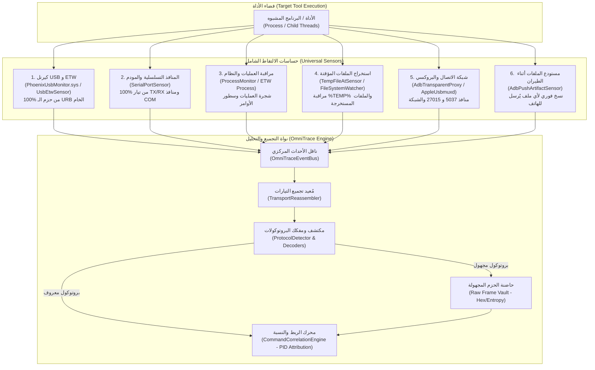

# Universal Device & Tool Telemetry (الالتقاط الشامل والحيادي لحركة الأدوات)

دليل هندسي وعملياتي لبناء وتشغيل طبقة مراقبة شاملة وعديمة الفقدان (**Zero-Drop, Non-Selective Monitoring**) ترصد جميع العمليات والأوامر وحزم البيانات التي تنفذها برامج وأدوات الصيانة والفحص والأمن السيبراني، دون الاقتصار على أوامر محددة أو بروتوكولات مسبقة التعريف.

---

## 1. الفلسفة الأساسية: المراقبة الشاملة عديمة الفقدان (Zero-Drop Telemetry)

تعتمد معظم الأدوات المتقدمة (GSM Tools, Exploits, Forensic bypasses) على تقنيات التخفي لتجاوز أنظمة المراقبة التقليدية:
- إرسال أوامر AT غير قياسية أو مشفرة عبر منافذ COM.
- استخدام بروتوكول ADB المضمن في الذاكرة (In-Memory Wire Protocol) دون تشغيل `adb.exe`.
- التخاطب المباشر مع معالجات الهواتف عبر USB Endpoints وحزم خام (Raw Hex / Vendor BROM / EDL).
- استخراج ملفات وحقن سكربتات في المجلدات المؤقتة `%TEMP%` وحذفها فوراً بعد التنفيذ.

**القاعدة الذهبية للنظام:**
> **لا يتم استثناء أو تجاهل أي بايت.** أي حركة تمر بين الأداة والكمبيوتر أو الهاتف يتم التقاطها وتأطيرها وحفظها، سواء كانت أمراً معروفاً أو حزمة بيانات ثنائية مجهولة (Unknown Binary Stream).

---

## 2. طبقات الاستشعار والالتقاط الشامل (Multi-Vector Capture Architecture)



---

## 3. تفاصيل متجهات الالتقاط (The 6 Capture Vectors)

### المتجه 1: التقاط حزم الـ USB على مستوى الكيرنل (Kernel USB URB Sniffing)
* **المسؤول:** `PhoenixUsbMonitor.sys` و `UsbEtwSensor` و `UsbPcap`.
* **نطاق الالتقاط:**
  - التقاط جميع حزم URB (USB Request Blocks) لكل من:
    - **Bulk OUT / Bulk IN:** قنوات نقل البيانات السريعة ونقل الفلاشات والملفات.
    - **Control Transfers:** إعدادات الجهاز وتبديل الوضعيات وأوامر المصنع.
    - **Interrupt Transfers:** إشعارات الأجهزة وحالات التغيير.
* **الضمان:** لا يمكن لأي برنامج تجاوز طبقة الكيرنل؛ حتى لو كتب المطور درايفر خاص، يتم تسجيل كل حزمة قبل خروجها للناقل الفعلي.

### المتجه 2: الالتقاط الكامل لمنافذ الـ COM والمودم (Raw Serial I/O)
* **المسؤول:** `SerialPortSensor`.
* **نطاق الالتقاط:**
  - مراقبة كافة منافذ الـ COM الافتراضية والحقيقية (`\\.\COM1` إلى `\\.\COM255`).
  - اعتراض تيار البيانات الثنائي (Raw Byte Stream) في الاتجاهين (TX من الكمبيوتر إلى الهاتف، و RX من الهاتف إلى الكمبيوتر).
  - لا يعتمد الحساس على فحص أوامر معينة، بل يسجل:
    - أوامر الـ AT النصية الكاملة (بما فيها الأوامر الاحتكارية الخاصة بسامسونج وهواوي وميديا تيك).
    - الحزم الثنائية الثابتة (Diagnostic Frames / HDLC Frames / Binary Modems).

### المتجه 3: مراقبة تنفيذ العمليات وشجرة الأنساب (Process Tree & Lineage)
* **المسؤول:** `ProcessMonitor` و `Windows ETW (Microsoft-Windows-Kernel-Process)`.
* **نطاق الالتقاط:**
  - كل عملية يتم إطلاقها: المسار الكامل، المعرف البرمجي (`ProcessId`)، المعرف الأب (`ParentProcessId`).
  - سطر الأوامر الكامل (`CommandLine`) مع كافة المعاملات والـ Flags.
  - مراقبة العمليات الخفية المحقونة أو المحمولة التي يتم إنشاؤها عبر `CreateProcess`, `ShellExecute`, أو `cmd.exe /c`.

### المتجه 4: مراقبة وتجميد الملفات المستخرجة محلياً (Staging & Dropper Vault)
* **المسؤول:** `TempFileAtSensor` و مراقب مسارات النظام.
* **المسارات الخاضعة للرقابة:**
  - `%LOCALAPPDATA%\Temp\`
  - `%USERPROFILE%\AppData\Roaming\`
  - `C:\ProgramData\`
  - مسار الأداة نفسه والمجلدات الفرعية.
* **آلية الرصد الفوري:**
  - رصد أحداث `Created`, `Changed`, `Renamed`.
  - بمجرد إنشاء الملف، يتم عمل **نسخة فورية (Forensic Snapshot)** منه وحساب الـ Hash (SHA256) قبل أن تقوم الأداة بحذفه.

### المتجه 5: وكيل البروتوكولات والشبكة الذكي (Transparent Proxies & Network)
* **المسؤول:** `AdbTransparentProxy` و `AppleUsbmuxdProxy` و `NetworkUrlSensor`.
* **نطاق الالتقاط:**
  - اعتراض منفذ `127.0.0.1:5037` (خادم ADB المحلي): تسجيل جميع أوامر الـ Smart Sockets، وأوامر `shell`, `exec`, `push`, `pull`, `sync`.
  - اعتراض منفذ `127.0.0.1:27015` (خادم Usbmuxd لأجهزة آبل): تسجيل حزم الـ Plist و Lockdown و DFU.
  - مراقبة اتصالات الـ TCP الصادرة لرصد خوادم الترخيص (License servers) أو خوادم التنزيل التلقائي لملفات الفلاش.

### المتجه 6: مستودع الحمولات أثناء الطيران (In-Flight Artifact Vault)
* **المسؤول:** `AdbPushArtifactSensor`.
* **الهدف:** إذا قامت الأداة بإرسال ملف تنفيذي أو Payload إلى الهاتف (مثل `su`, `frida-server`, `busybox`, أو ملفات `.sh` أو `.apk`):
  - يتم استخراج الملف وتخزينه في مستودع الأدلة الجنائية للمعاينة دون إيقاف العملية.

---

## 4. استراتيجية تفكيك وتحليل الحزم (Universal Decoding & Unknown Payload Handling)

عندما تصل حزم البيانات إلى المحرك، يتم التعامل معها عبر استراتيجية مستويين:

```
                  ┌──────────────────────────────┐
                  │ تدفق الحزم الملتقطة (Raw I/O) │
                  └──────────────┬───────────────┘
                                 │
                    ┌─────────────┴─────────────┐
                    ▼                           ▼
         [بروتوكول معروف وتطابق النمط]      [بروتوكول غير معروف أو بيانات ثنائية]
                    │                           │
                    ▼                           ▼
      ┌───────────────────────────┐  ┌───────────────────────────────────┐
      │ فك التشفير المنطقي الكامل: │  │ المعالجة الشاملة للحزم المجهولة:   │
      │ - ADB / Fastboot          │  │ 1. تسجيل الـ Hex Dump الكامل      │
      │ - AT Modem (Samsung/MTK)  │  │ 2. استخراج النصوص المقروءة ASCII   │
      │ - MTK BROM / DA           │  │ 3. حساب درجة العشوائية (Entropy)   │
      │ - Qualcomm Sahara/Firehose│  │ 4. تحديد Magic Bytes للملفات       │
      │ - Unisoc FDL              │  │ 5. ربط الحزمة بالـ PID للأداة      │
      │ - Apple Lockdown/DFU/Muxd │  │ 6. حفظ الحزمة كـ Forensic Evidence │
      └───────────────────────────┘  └───────────────────────────────────┘
```

### معايير حفظ الحزم المجهولة (Raw Handling Rules):
1. **عدم الإهمال مطلقاً:** الحزمة المجهولة لا تُعتبر خطأ، بل تُسجل كـ `RawBinaryCommand` أو `GenericPayload`.
2. **استخراج النصوص المضمنة (String Carving):** تفريغ أي نصوص ASCII أو UTF-8 مدمجة داخل الحزم الثنائية (مثل روابط URL، مسارات ملفات، أو نصوص أوامر شل).
3. **فحص الـ Entropy:**
   - عشوائية منخفضة (< 5.0): نصوص، جداول بيانات، أو إعدادات غير مشفرة.
   - عشوائية عالية (> 7.2): ملف مضغوط، كود مشفر، فلاشة محمية، أو مفتاح تشفير.

---

## 5. محرك الربط وتحديد هوية الأداة (Correlation & Process Attribution)

لكل حدث يتم التقاطه عبر أي حساس، يقوم محرك `CommandCorrelationEngine` بإنشاء كائن حدث قياسي موحد (`LogicalCommandEvent`):

| الحقل (Field) | الوصف |
| :--- | :--- |
| **`Timestamp`** | التوقيت الدقيق بالميكروثانية. |
| **`ProcessId` (PID)** | معرف العملية التي أصدرت الأمر أو فتحت المقبض. |
| **`ProcessName`** | اسم الملف التنفيذي للأداة (مثل `UnlockTool.exe`). |
| **`ParentProcess`** | العملية الأب التي أطلقت الأداة. |
| **`Channel`** | قناة الاتصال (`USB`, `SERIAL_COM`, `ADB_SOCKET`, `FILE_SYSTEM`, `NETWORK`). |
| **`Direction`** | اتجاه الحركة (`HostToDevice` - الصادر، `DeviceToHost` - الوارد). |
| **`RawBytesHex`** | التمثيل الست عشري الكامل للبيانات الخام. |
| **`DecodedSummary`** | التفسير المنطقي المقروء إن وجد، أو وصف الحزمة الخام. |
| **`ArtifactPath`** | مسار النسخة المحفوظة للملف إذا كانت العملية تتضمن نقل أو استخراج ملف. |

---

## 6. إجراءات التحقق وضمان الاكتمال (Completeness Assurance Runbook)

عند تشغيل النظام أو إجراء اختبارات للتحقق من عدم تسرب أي أمر:
1. **فحص جاهزية الحساسات:**
   - التأكد من تحميل درايفر الكيرنل أو تنشيط جلسة ETW.
   - التأكد من فتح منفذ وكيل الـ ADB `5037` واستقبال الاتصالات.
   - فحص وجود منافذ الـ COM النشطة واشتراك `SerialPortSensor` فيها.
2. **محاكاة أداة صامتة (Silent Bypass Test):**
   - تنفيذ اختبار يقوم بكتابة حزم مباشرة إلى منفذ الـ COM بدون تشغيل `adb.exe`.
   - التأكد من ظهور الحزمة فوراً في لوحة المراقبة مع الـ Hex والـ PID الخاص بالاختبار.
3. **فحص منع الإسقاط (Drop-Free Buffer Management):**
   - استخدام طوابير انتظار معزولة ومقيدة (`Bounded Channel Queue`) في `OmniTraceEventBus` لضمان عدم فقدان أي حزمة حتى تحت الضغط العالي ونقل الفلاشات الضخمة.
